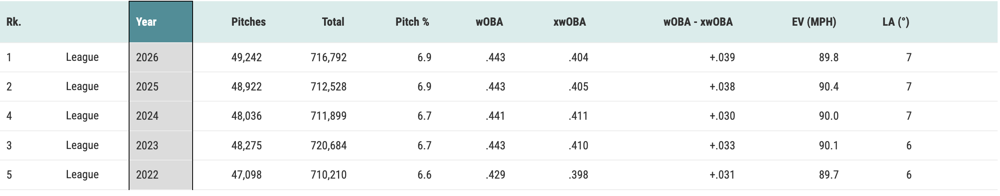
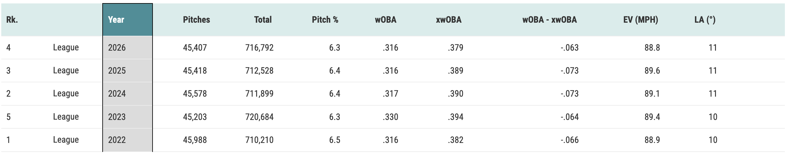
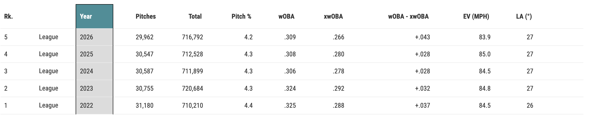
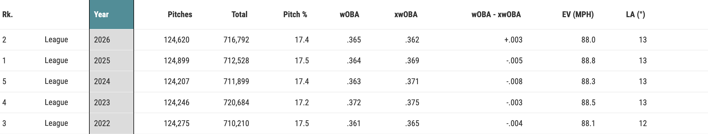

# Simple Directional xwOBA

## Introduction:

Weighted On-Base Average (wOBA) is the current industry standard statistic to condense a batter’s performance into a single number. It is a rate stat that sums the number of unintentional walks, hit by pitches, singles, doubles, triples, and home runs a player has (weighted by the relative value of each of these outcomes) and divides by the sum of at-bats, unintentional walks, sacrifices, and hit by pitches.

There is a lot of random chance that takes place during a baseball season. Therefore, to better understand a batter’s true talent, the stat of expected wOBA (xwOBA) was created. xwOBA takes in a batted ball’s launch angle, the angle relative to the ground the ball comes off the bat,  and its exit velocity off the bat and uses a nearest-neighbors approach to compare that batted ball to past batted balls that were similar. The goal is to generate probabilities for that batted ball being an out, single, double, triple, or home run. We can then take a weighted average of these probabilities and the relative value of each outcome to compute the expected wOBA (xwOBA) for that batted ball. If we do this for all batted balls, we can then calculate a batter’s season-wide xwOBA by replacing all of the batted ball terms in the numerator (single, double, triple, home run) with the sum of the batter’s xwOBA for all of their batted balls. We keep the other outcomes, like walks and hit-by-pitches the same.

xwOBA was created to describe the player (and their true talent and performance level), and not to describe the individual play. Therefore, it does not include spray angle, which is the angle from the first-base line to the third-base line that tells you if a ball was pulled, hit to center field, or hit the other way. The thinking behind this is that spray angle is often noise and is not a repeatable skill, and therefore focuses too much on the individual play rather than the player. In fact, past research has shown that including spray angle in the model that generates the outcome probabilities used to calculate xwOBA causes the resulting “3D xwOBA” to overfit (Year 1 3D xwOBA has a lower R^2 with Year 2 wOBA than Year 1 normal xwOBA does with Year 2 wOBA). More information on this can be found in this blog post by Tom Tango: https://tangotiger.com/index.php/site/article/spray-angle-overfits-xwoba.

However, batted ball direction does significantly impact batted ball results (and therefore their wOBA). Pulled balls and opposite field balls significantly outperform their xwOBA. This can be attributed to factors such as the outfield fences being shorter in left and right field than in center field and the fact that pulled balls travel further in general due to having additional back-spin off the bat. Meanwhile, balls hit straightaway to center field underperform their xwOBA by an even greater margin.

<figure>
  <figcaption>League-wide wOBA vs xwOBA on all pulled batted balls from each year from 2022 to 2026, significant wOBA overperformance. Screenshot taken from Baseball Savant website.</figcaption>
   
  
</figure>

<figure>
  <figcaption>League-wide wOBA vs xwOBA on all straightaway batted balls from each year from 2022 to 2026, significant wOBA underperformance. Screenshot taken from Baseball Savant website.</figcaption>
   
  
</figure>

<figure>
  <figcaption>League-wide wOBA vs xwOBA on all opposite batted balls from each year from 2022 to 2026, significant wOBA overperformance. Screenshot taken from Baseball Savant website.</figcaption>
   
  
</figure>

<figure>
  <figcaption>League-wide wOBA vs xwOBA on all batted balls from each year from 2022 to 2026. When including all batted balls, wOBA and xwOBA match up quite well, showing the differences in wOBA-xwOBA for each batted ball direction isn’t due to an overall failing of xwOBA, but rather to the batted ball direction itself. Screenshot taken from Baseball Savant website.</figcaption>
   
  
</figure>

Traditional xwOBA ignores batted ball direction entirely, causing it to undervalue players who do a good job of pulling the ball (especially pulling the ball in the air, the most valuable batted ball type), and overvalue players who hit a lot of balls straightaway to center field.

However, certain players have consistently pulled the ball more than the league average (or hit the ball the other way or straightaway more than league average) across their careers spanning several seasons. Additionally, offensive improvements for players many times involve the player making deliberate changes to their mechanics or approach in order to pull more of their batted balls. Therefore, we have reason to believe that batted ball direction is in part a repeatable skill.

Therefore, in this project I want to explore the idea of Simple Directional xwOBA. Spray angle proved to be too granular for xwOBA calculations, but I want to explore to see if just the overall batted ball direction of “Pull”, “Straightaway”, or “Opposite” can help correct issues stemming from xwOBA’s lack of batted ball direction and create a stat that is more correlated with future wOBA than xwOBA is. The only difference between xwOBA and Simple Directional xwOBA is that while xwOBA considers only a batted ball’s launch angle and exit velocity in its nearest-neighbors approach to calculating the probabilities of each outcome, Simple Directional xwOBA (sd-xwOBA) incorporates batted ball direction along with launch angle and exit velocity.

## Methodology:

Firstly, all of the Statcast batted ball data from the 2022 through 2026 regular seasons was downloaded from the Baseball Savant website, with hit direction being determined by the batted ball direction filter of Baseball Savant’s Search feature. This data was then cleaned.

The approach to calculating sd-xwOBA and xwOBA-local (the version of xwOBA that my workflow calculated as opposed to xwOBA-MLB, which is Statcast’s version of xwOBA) was informed by this blog post by Thomas Nestico: https://medium.com/@thomasjamesnestico/modelling-xwoba-with-knn-9b004e93861a.

A KNN model, developed using the scikit-learn library, was trained to predict the probabilities of each of the five batted ball outcomes of out, single, double, triple, and home run based on a batted ball’s launch angle, exit velocity (and hit direction for sd-xwOBA). These multiclass prediction models were evaluated using log loss and a multiclass Brier score. A total of 97 different models with different hyperparameters were tested to identify the best one.

The models were trained and evaluated using the batted ball data from 2022, 2023, and 2024. A 5-fold cross validation was performed on all 3 years of data. Additionally, to test model generalizability across seasons, a chronological validation was used where models were trained on the 2022 and 2023 data and evaluated on the 2024 data.

Model performance between the cross validation and chronological validation was similar.

For xwOBA-local, the best performing model that was chosen for calculating xwOBA-local for 2025 and 2026 batted balls was the no feature scaling, 1000-neighbor, uniform-weighted Manhattan distance KNN model. This model had the lowest log loss of 0.569540 for the cross validation and 0.566065 for the chronological validation while being very close to the lowest Brier score of 0.315680 in the cross validation and 0.313385 in the chronological validation.

For sd-xwOBA, the best performing model was the robust scaling, 1000neighbor, uniform weight, Euclidean distance KNN model. This model had the lowest log loss of 0.537843 in the cross validation and 0.539198 in the chronological validation. It also had close to the lowest Brier score, with 0.298698 in the cross validation and 0.298509 in the chronological validation.

Once the best model was identified, this model was trained on all batted ball data from 2022, 2023, and 2024, and was used to predict the batted ball outcome probabilities for every batted ball from 2025 and 2026. These outcome probabilities were then combined with the wOBA coefficients from FanGraphs to calculate the xwOBA-local and sd-xwOBA for every batted ball from 2025 and 2026.

This batted ball xwOBA-local and sd-xwOBA data, along with Statcast’s xwOBA-MLB data was used to calculate player-season level xwOBA-local, xwOBA-MLB, and sd-xwOBA as well as their batted ball only equivalents of wOBAcon, xwOBAcon-MLB, xwOBAcon-local, and sd-xwOBAcon for all qualified batter seasons from 2025 and 2026.

## Key Results:

### Adding batted ball direction enabled sd-xwOBA to describe the individual play/batted ball event better.

Across the 2025 and 2026 seasons, at the batted ball level, the correlation between a given batted ball’s wOBA and its:

- xwOBAcon-MLB: 0.67090868941622
- xwOBAcon-local: 0.6703673299333682
- sd-xwOBAcon: 0.719766204427686

We can see that a batted ball’s sd-xwOBAcon (which for a batted ball is the same as its sd-xwOBA) is more strongly correlated with its true wOBA value than either xwOBA metric is with its true wOBA value. This makes sense as by providing sd-xwOBA with batted ball direction allows it to account for the impact batted ball direction has on wOBA, which xwOBA is not able to do.

### However, sd-xwOBA does not describe a player’s true performance level better.

For all 80 players with qualified seasons in 2025 and 2026:

- The correlation between Year 1 (2025) xwOBA-MLB and Year 2 (2026) wOBA: 0.2973763756761183
- The correlation between Year 1 (2025) xwOBA-local and Year 2 (2026) wOBA: 0.2984694240271299
- The correlation between Year 1 (2025) sd-xwOBA and Year 2 (2026) wOBA: 0.2801397278497203

Now, wOBA, xwOBA, and sd-xwOBA at the player season level includes more factors, like walks and strikeouts, that our inclusion of batted ball direction has no direct bearing on.

However, we can see the same pattern of sd-xwOBA actually having a slightly lower year-to-year correlation than the other two xwOBA metrics even if we focus on just batted balls, which batted ball direction would impact directly.

For all 80 players with qualified seasons in 2025 and 2026:

- The correlation between Year 1 (2025) xwOBAcon-MLB and Year 2 (2026) wOBAcon: 0.6181150141245288
- The correlation between Year 1 (2025) xwOBAcon-local and Year 2 (2026) wOBAcon: 0.6095731315697537
- The correlation between Year 1 (2025) sd-xwOBAcon and Year 2 (2026) wOBAcon: 0.6116667125968412

Note that the xwOBA metrics for the entire player-season correlate more strongly with future wOBA than current wOBA does. The correlation between Year 1 (2025) wOBA and Year 2 (2026) wOBA is 0.2668178408349066.

Meanwhile, the correlation between Year 1 (2025) wOBAcon and Year 2 (2026) wOBAcon of 0.6111259213964152 is very similar to the correlation between the Year 1 xwOBAcon and Year 2 wOBAcon.

One clear avenue for future exploration is machine learning model type. The current analysis used a KNN model to generate batted ball outcome probabilities as this is what Statcast’s approach is based on. However, in the future, other model types that tend to be more accurate, such as random forest or XGBoost models, can be explored for generating the batted ball outcome probabilities.
